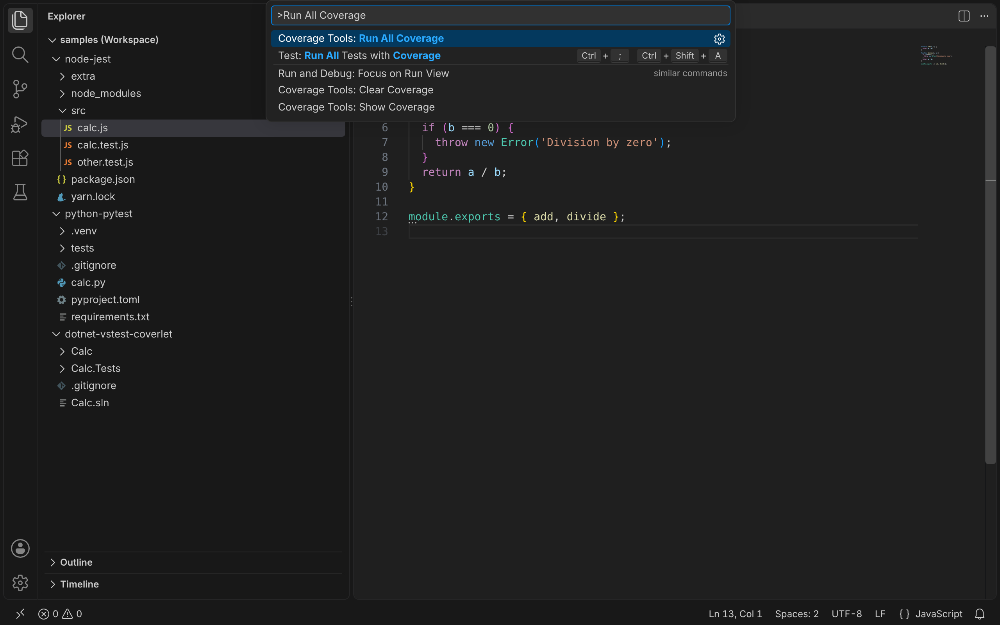
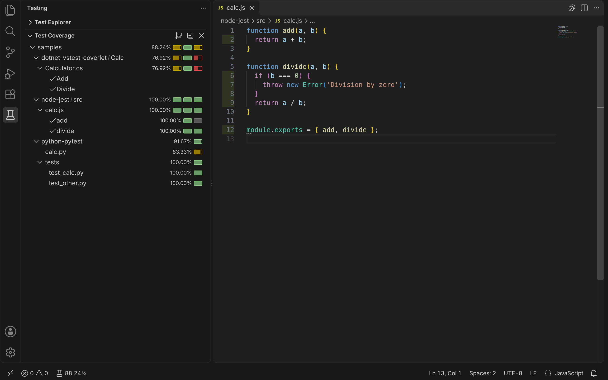
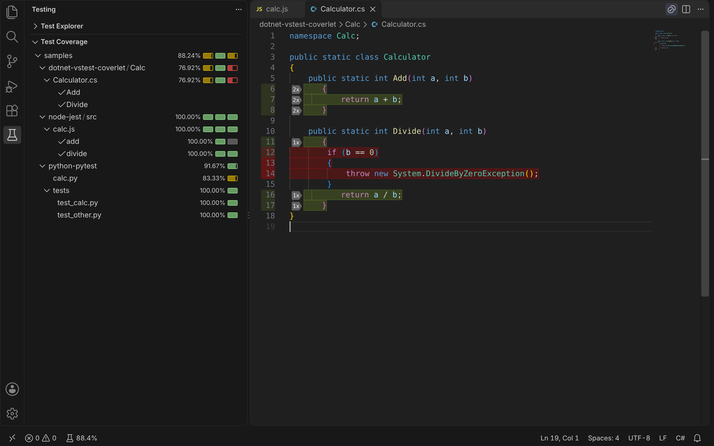
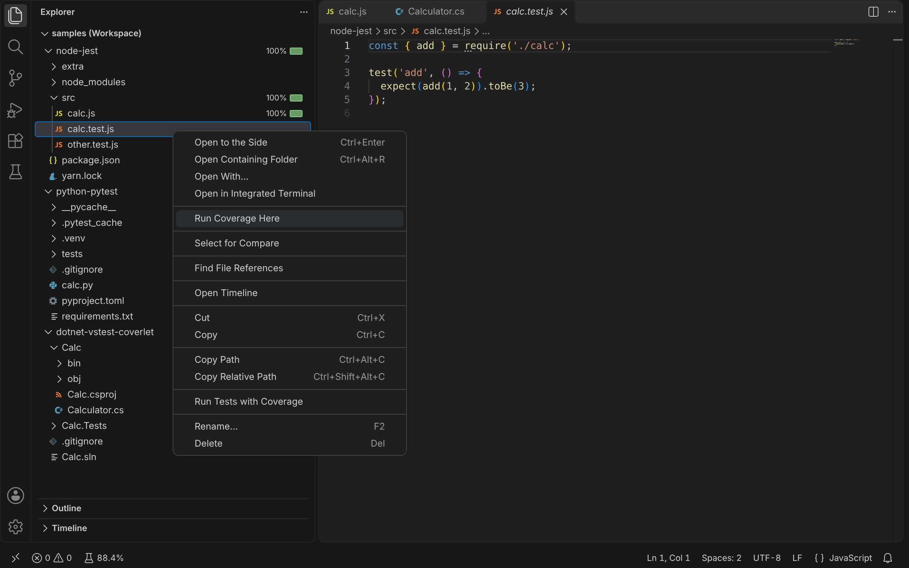
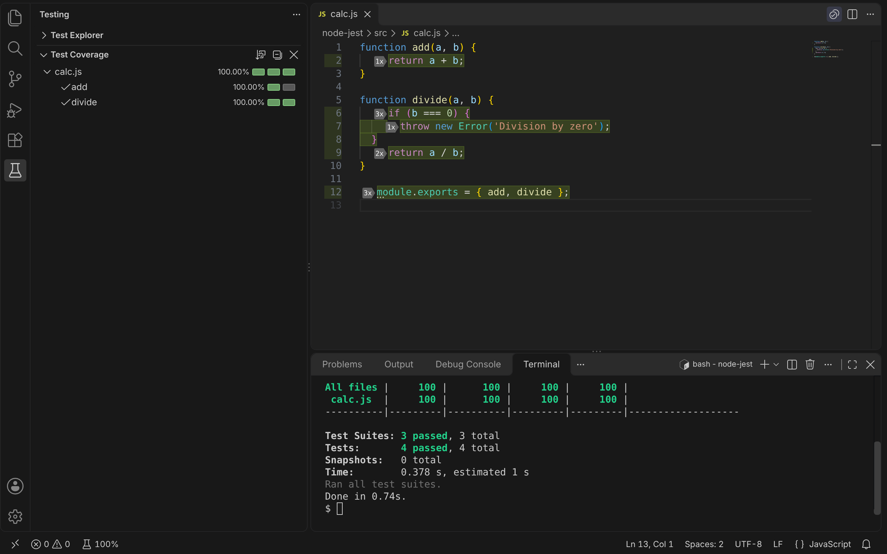
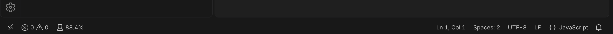

# Coverage Tools

**See the test coverage of your whole workspace at once, in VS Code's native coverage UI.**

See [What's included](#whats-included) and [CHANGELOG.md](CHANGELOG.md).

## The problem

VS Code can show test coverage natively: the **Test Coverage** view, a
percentage and a red/yellow/green bar per file, and covered/uncovered lines in
the editor. But it shows **one test run at a time**. In a workspace with
several projects, or several folders (multi-root), running coverage for
project B makes project A's coverage disappear. To know where the whole
workspace stands you have to keep re-running and switching between projects.

## What Coverage Tools does

Coverage Tools is an **accumulator**. It keeps the coverage of every project
in your workspace in memory and shows all of it together through the same
native UI, whatever mix of .NET, Node, and Python projects you have open:

```
TEST COVERAGE
▾ api            (workspace folder 1, .NET)
    Services/OrderService.cs      █████████░  91%
    Services/TaxService.cs        ███░░░░░░░  34%
▾ web            (workspace folder 2, Node)
    components/Cart.tsx           ████████░░  80%
▾ jobs           (workspace folder 3, Python)
    jobs/cleanup.py               ██████░░░░  62%
```

- **Accumulates across projects.** Running one project updates only that
  project's numbers. Everything else stays on screen.
- **Looks native, because it is.** It publishes through VS Code's Testing API:
  per-file and per-folder percentages, coverage bars, and line-by-line
  highlighting in the editor. Bar colors follow VS Code's own
  `testing.coverageBarThresholds` setting.
- **Picks up coverage runs automatically.** Run your tests with coverage from
  the terminal, a task, or a script, and the result is loaded as soon as the
  report is written.
- **Runs everything in one go.** One command runs coverage for every test
  project in the workspace.
- **Runs just what you point at.** Right-click a test project, a folder, or a
  test file in the Explorer to run coverage for that target only. The menu
  item appears only where there are tests to run.
- **Stays out of your way.** Built to be very light: it does nothing at
  startup, nothing while idle, and reads reports off the main extension
  thread. See [Lightweight by design](#lightweight-by-design).
- **Shows the same number as VS Code.** The status bar total is the
  percentage the Test Coverage view shows for the root of its tree.
- **Stays until you replace it.** Coverage remains displayed until a new
  coverage run updates it or VS Code restarts. Nothing is saved between
  sessions.

## Supported test stacks

Coverage Tools adapts to what it finds. It does not assume a project layout,
a `test` script, or a particular coverage package.

| Ecosystem | Test tool | How the extension runs it | Run a single file or folder |
|-----------|-----------|---------------------------|-----------------------------|
| .NET (C#) | VSTest test projects (xUnit, NUnit, MSTest) | `dotnet test` with the coverage collector the project has (coverlet's collector or coverlet.msbuild), otherwise the collector that ships with the test SDK | Yes, by test class |
| .NET (C#) | Microsoft.Testing.Platform test projects (MSTest, NUnit, xUnit v3, TUnit) | `dotnet run` of the test project with `--coverage` | Yes, by test class (xUnit v2 on the platform: whole project only) |
| Node | Jest | the `test` script if it runs Jest, otherwise Jest directly, with coverage on | Yes |
| Node | Vitest | the `test` script if it runs Vitest, otherwise Vitest directly, with coverage on | Yes |
| Node | Anything else (Mocha, AVA, `node --test`, Jasmine, tap, …) | the `test` script wrapped in a bundled [c8](https://github.com/bcoe/c8) | No, whole project only |
| Python | pytest or `unittest` | pytest-cov if installed, otherwise coverage.py | Yes |

Single projects and monorepos both work without configuration. When test
projects are nested, the inner ones are run by default; set
`coverageTools.nestedProjects` to `outer` if your root project runs
everything. For anything the table does not cover, give the extension your own
command per project with the `coverageTools.commands` setting.

Coverage runs made outside the extension are detected by the report they
write, whatever tool wrote it:

| Report | Format | Typically written by |
|--------|--------|----------------------|
| `**/TestResults/**/*.cobertura.xml` | Cobertura | `dotnet test` with a collector |
| `**/coverage/coverage-final.json` | Istanbul JSON | Jest, Vitest, nyc, c8 |
| `**/coverage/lcov.info` | LCOV | Jest, Vitest, nyc, c8, `node --test` |
| `**/coverage/cobertura-coverage.xml` | Cobertura | Jest, Vitest, nyc, c8 |
| `**/coverage.xml` | Cobertura | pytest-cov, coverage.py |
| `**/coverage.lcov` | LCOV | pytest-cov, coverage.py |
| `**/.coverage` | coverage.py data | `pytest --cov`, `coverage run` |

A test run only produces data if it writes one of these. A plain
`dotnet test`, `yarn test`, or `pytest` without coverage options is ignored.

## Usage

The screenshots below are real captures of the extension running on the
sample workspace in this repository (`samples/`: a Jest, a pytest and a .NET
project). `npm run screenshots` takes them again.

1. **Run everything.** Open the Command Palette and run
   `Coverage Tools: Run All Coverage`. Every test project in the workspace
   runs, one at a time, and the Test Coverage view fills in as each finishes.

   

2. **Read the result.** The Test Coverage view lists every covered file from
   every project, with its percentage and bar.

   

3. **See it line by line.** Open any listed file to see covered and uncovered
   lines in the editor. Run `Test: Toggle Inline Coverage` to highlight them
   inside the code, with hit counts.

   

4. **Run one target.** Right-click a test project, a folder, or a test file in
   the Explorer and choose `Run Coverage Here`.

   

5. **Or just use your terminal.** Run your tests with coverage as you always
   do. The view updates when the report is written.

   

6. **Bring it back.** The status bar shows the accumulated total. If another
   extension's test run replaces the display, click that item, or run
   `Coverage Tools: Show Coverage`.

   

## Commands

| Command | Where | What it does |
|---------|-------|--------------|
| `Coverage Tools: Run All Coverage` | Command Palette, Testing view title | Runs coverage for every discovered test project, one at a time |
| `Coverage Tools: Run Coverage Here` | Explorer right-click menu | Runs coverage for the selected project, folder, or test file |
| `Coverage Tools: Show Coverage` | Command Palette, status bar | Brings the accumulated coverage back on screen |
| `Coverage Tools: Clear Coverage` | Command Palette | Empties the accumulated coverage and closes the native view |

A status bar item shows the accumulated total and whether a run is in
progress. The total is computed exactly as the Test Coverage view computes the
percentage of a row (statements, branches and functions together, or what
`testing.displayedCoveragePercent` selects), with the same two decimals. Its
tooltip lists the total of each project.

## How accumulation works

- A **full run of a project** replaces that project's data.
- A **partial run from the right-click menu** (a folder or a single test file)
  adds to that project's data, so nothing already covered is lost.
- If two test projects cover the same source file, their counts are combined
  in the display.
- A coverage run detected from outside the extension is treated as a full run
  of its project.

## Lightweight by design

Being light is a core requirement, not an afterthought. The extension is
built to these rules, and an automated performance suite checks every change
against them:

- **No startup cost.** It activates after VS Code has finished starting, and
  reads no files, starts no timer and creates no watcher when it does.
  Measured on a development machine: 12 to 16 ms to load and activate (the
  activate call itself takes under 2 ms).
- **Truly idle.** No timers, no worker threads and no periodic scans at rest.
  It listens to VS Code's file-change notifications through one watcher per
  workspace folder; 50,000 unrelated file events cost about 24 ms in total.
- **Background discovery.** Finding your test projects happens in small steps
  after startup, and only the affected part is redone when something changes.
  Discovering 30 projects among 20,000 files blocks the extension host for at
  most about 13 ms at a time.
- **Reports are read off the main thread.** Coverage reports are parsed in a
  worker. A 54 MB Cobertura report of 5,000 files blocks the extension host
  for at most about 35 to 45 ms at a time, and holding it accumulated and
  published takes about 32 MB of memory, which stays flat across repeated
  re-runs.
- **Detail on demand.** Only per-file totals are published. Line-by-line
  detail is loaded when you open a file.
- **One run at a time.** Test runs are separate processes, queued so your
  machine stays usable.
- **Small.** The bundled code is about 100 KB.
- **No telemetry and no network access.**

## Settings

| Setting | Default | Purpose |
|---------|---------|---------|
| `coverageTools.watch.enabled` | `true` | Detect coverage reports written by runs made outside the extension (terminal, tasks, scripts) |
| `coverageTools.watch.globs` | the seven report patterns listed above | Glob patterns, relative to each workspace folder, of the coverage reports to detect |
| `coverageTools.exclude` | `**/node_modules/**`, `**/bin/**`, `**/obj/**`, `**/.venv/**`, `**/venv/**`, `**/.tox/**`, `**/.nox/**`, `**/.conda/**`, `**/site-packages/**`, `**/build/lib/**`, `**/__pycache__/**` | Paths ignored during discovery and watching |
| `coverageTools.nestedProjects` | `inner` | When test projects of the same ecosystem are nested, run the inner ones (`inner`) or the outer one (`outer`) |
| `coverageTools.dotnet.collector` | `""` (chosen from the project's packages) | Forces the value passed to `--collect` for VSTest projects, for example `XPlat Code Coverage` |
| `coverageTools.dotnet.extraArgs` | `[]` | Extra arguments for .NET test runs: for VSTest projects they are added to `dotnet test`; for Microsoft.Testing.Platform projects they are passed to the test application (after `--`) |
| `coverageTools.node.extraArgs` | `[]` | Extra arguments for the Node test command (Jest, Vitest, or the test script run under c8) |
| `coverageTools.python.interpreter` | `""` (auto-detect) | Python interpreter used to run tests and convert `.coverage` files. Empty: the project's `.venv` or `venv`, then the interpreter selected in the Python extension, then `python3` (on Windows: `py`, `python`, `python3`) |
| `coverageTools.python.extraArgs` | `[]` | Extra arguments for the Python test runner (pytest or unittest) |
| `coverageTools.commands` | `{}` | Your own coverage command per project: maps a project directory, relative to the workspace folder, to a command line run there through the shell. `${coverageDir}` is replaced with a temporary directory where the command must write an Istanbul JSON, Cobertura or LCOV report. The directory becomes a project (full runs only) and replaces any project found inside it |

## Requirements

- VS Code 1.90 or later.
- **.NET:** the .NET SDK. VSTest projects need nothing else.
  Microsoft.Testing.Platform projects need the code coverage extension: with
  MSTest.Sdk it is on by default; otherwise the project needs the
  `Microsoft.Testing.Extensions.CodeCoverage` package.
- **Node:** Node.js 18 or later for the bundled c8, and the project's own test
  tool. Vitest also needs its coverage provider (`@vitest/coverage-v8`).
- **Python:** `coverage` or `pytest-cov` in the project's environment.

## Known limitations

**Display and data**

- **Other extensions can take over the display.** If you run coverage through
  C# Dev Kit, the Jest extension, the Python extension or VS Code's own
  `Run Tests with Coverage`, VS Code switches to that run. Your accumulated
  coverage is still held; `Coverage Tools: Show Coverage` (or a click on the
  status bar item) brings it back.
- **Coverage can go stale.** If you edit a file after a run, the highlighted
  lines may no longer match until you run again. Native coverage behaves the
  same way.
- **Partial runs from the terminal count as full runs** and replace the
  project's data. Use the right-click menu for partial runs that add up.
- **Nothing is persisted.** Coverage starts empty every time VS Code starts,
  and reports already on disk are not loaded.
- **Old runs show today's lines.** Opening an earlier run from VS Code's Test
  Results history shows the current line-by-line detail, not the detail of
  that moment (the history would otherwise keep every old copy in memory).
- **Untrusted workspaces are read-only.** In a workspace you have not marked
  as trusted, the extension runs no commands. It only reads coverage reports
  that appear.
- **coverage.py data files are converted automatically.** In a trusted
  workspace, a coverage.py `.coverage` file that appears in the workspace is
  converted with the project's Python interpreter without any action from you.
- **`Run Tests with Coverage` is VS Code's, not ours.** Those entries belong
  to VS Code's test explorer and do not start Coverage Tools; use
  `Run Coverage Here`.

**Node**

- **Node tools other than Jest and Vitest** run as a whole project only.
- **TypeScript run through tsx or ts-node under c8** shows a few extra
  functions and branches on line 1, and marks the `export function` line of a
  function that never ran as covered.
- **c8's exclude list.** The exclude list the extension passes to c8 replaces
  a project's own c8 or nyc `exclude` setting.
- **Very large selections on Windows.** Running a folder with a great many
  test files at once can exceed the Windows command-line length limit, because
  each selected test file is passed on the command line; run the whole project
  or a smaller folder instead.

**.NET**

- **Partial runs select test classes by name.** A run of one test file can
  also pick up a same-named class in another namespace (for example
  `Tests.CalcTests` and `UnitTests.CalcTests`).
- **Generic and inherited test classes.** A partial run of a generic test
  class can also run another class whose name starts the same, and tests
  declared in an abstract base class run only when you run the file of the
  derived class.
- **TUnit and the global namespace.** With TUnit, a partial run that includes
  a test class in the global namespace also runs same-named classes in every
  namespace.
- **Multi-targeted projects.** A VSTest project with several target
  frameworks produces one report per framework, and only the newest is kept;
  Microsoft.Testing.Platform projects run their first target framework only.
- **Conditional runner settings.** Runner switches (such as
  `UseMicrosoftTestingPlatformRunner`) set inside a conditional group of
  `Directory.Build.props` are not seen.

**Custom commands**

- **A custom command on a folder that is not a project of its own**, inside a
  project the extension recognizes (for example a `legacy/` folder inside a
  Jest project), keeps that enclosing project. Its full run uses its own tool
  over the whole project and can still run tests inside the custom folder;
  only partial runs leave that folder out.

**Platforms**

- The extension is exercised end to end by automated tests on Linux. Its unit
  tests also run on Windows and macOS.

## What's included

| Feature |
|---------|
| Accumulated coverage in the native UI |
| Status bar total, matching the native percentage |
| Show Coverage and Clear Coverage |
| Automatic detection of coverage reports (Cobertura, Istanbul JSON, LCOV, coverage.py data) |
| Run All Coverage |
| Run Coverage Here (Explorer right-click) |
| .NET support: VSTest |
| .NET support: Microsoft.Testing.Platform |
| Node support: Jest |
| Node support: Vitest |
| Node support: any other tool, through c8 |
| Python support: pytest and unittest |
| Custom command per project |
| Read-only mode in untrusted workspaces |

## Installation

- **From the Marketplace:** in VS Code, open the Extensions view and search
  for "Coverage Tools", or run `ext install DaniloFG.coverage-tools` from Quick
  Open (`Ctrl+P` / `Cmd+P`).
- **From a `.vsix` file:** download `coverage-tools-<version>.vsix` from the
  [GitHub Releases page](https://github.com/DaniloFG/CoverageTools/releases),
  then run **Extensions: Install from VSIX...** from the Command Palette and
  pick the file.

Maintainers: see [CONTRIBUTING.md](CONTRIBUTING.md#publishing) for how
releases are built and published.

## Changelog

See [CHANGELOG.md](CHANGELOG.md).

## License

[MIT](LICENSE)
